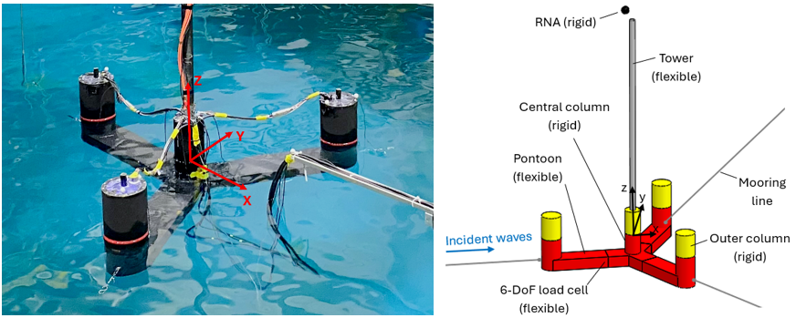
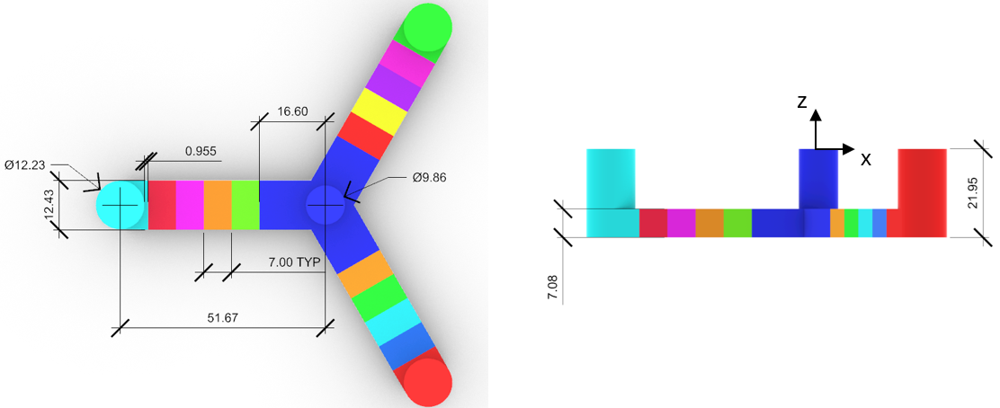

# `OC7_PhaseII_VolturnUS_PotFlow`

This numerical model was used in the OC7 Phase II (WP 2.1) project, where it is designated **NLR2**. The strip-theory counterpart of this model is `OC7_PhaseII_VolturnUS_Strip` (NLR1).

The model is based on the properties of the Floating Offshore-wind Controls Advanced Laboratory (FOCAL) Experimental Program - Campaign IV: 1:70 Model-scale Testing of the IEA-Wind 15MW Reference Turbine and the VolturnUS-S Platform (https://doi.org/10.21947/1972267).

It was used for wave-only conditions and includes a flexible version of the VolturnUS-S platform, representing the pontoons flexibility, and a rigid rotor-nacelle-assembly (RNA) modeled as a lumped mass and inertia.

# Model description

- SubDyn: Flexible tower and platform using rectangular beam elements, plus spring elements representing the flexibility of the load cells used in the experiments. Rigid links and concentrated masses model the rigid components (columns, RNA).
- HydroDyn: Hybrid model combining a potential-flow multi-body formulation (16 bodies plus 1 dummy body) with strip-theory elements. The strip-theory part uses a velocity-filtered drag formulation and cylindrical and rectangular hydrodynamic elements.
- MAP++: The horizontal pretensioned mooring lines used in the experiments, represented as linear springs. 

# Potential-flow discretization

The platform is divided into separate potential-flow bodies so that the flexible response of the pontoons can be captured. Each color in the figure identifies one body (outer columns, central column and pontoon segments).

# HydroData

The `HydroData` folder contains the potential-flow (WAMIT) solution and the wave elevation time series. It also contains two subfolders, `Only_Froude-Krylov` and `Only_Scattering_forces`. In these, NLR reran the WAMIT solution and separated the wave excitation into its Froude-Krylov contribution (`*.3fk` files) and its scattering contribution (`*.3sc` files). Both are expressed at the same physical location as the original `*.3` files. The information from `Only_Froude-Krylov` allows to reproduce Load Case 4.0 from the OC7 Phase II project.

# Test

The model is set up for Load Case 4.3, with the following irregular-wave conditions:

| Parameter                  | Symbol | Value | Unit |
|----------------------------|--------|-------|------|
| Wave type                  | -      | Irregular (JONSWAP) | - |
| Significant wave height    | Hs     | 8.1   | m    |
| Peak spectral period       | Tp     | 12.8  | s    |
| Peak enhancement factor    | γ      | 2.75  | -    |
| Full time-series duration  | t      | 9,754 | s    |

To reproduce the complete load case, set `TMax` in the main input file (`.fst`) and `WaveTMax` in the SeaState input file to 9754.

The `HydroData` folder also contains the wave elevation time series for Load Cases 4.1 and 4.2. To run those cases, update the following parameters according to the OC7 Phase II definition document:

- the hydrodynamic drag coefficients,
- the drag velocity-filter parameters (weighting factor and cut-off frequencies),
- the additional linear damping.

All of these changes are made in the HydroDyn input file.

# References

Platform elastic frequencies: https://iopscience.iop.org/article/10.1088/1742-6596/3224/8/082024  
Platform member-level loads: https://dx.doi.org/10.2139/ssrn.7549537      